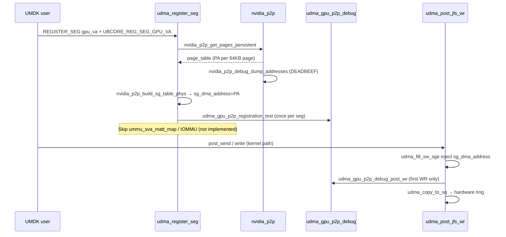

# GPU P2P DMA Debug Flow (Phase-0)

## Overview



## Step 1 — Segment registration bypass

**File:** `udma_segment.c` → `udma_pin_pages_and_ioummu_map()`

| Condition | Action |
|-----------|--------|
| `flag & UBCORE_REG_SEG_GPU_VA` | `udma_gpu_pin_seg_pages()` |
| else | existing `pin_user_pages` + UMMU map |

GPU path **does not** call:

- `udma_ioummu_remote_map()` — **missing for GPU PA**
- `udma_iommu_local_map()` — **missing for GPU PA**
- `ummu_sva_matt_map()` — **missing for GPU PA**

## Step 2 — NV address dump (Scheme A)

**File:** `nv-p2p.c` → `nvidia_p2p_debug_dump_addresses()`

For each 64KB page:

| Field | Source |
|-------|--------|
| VA | `gpu_va + i * 65536` |
| PA | `page_table->pages[i]->physical_address` |
| BAR | same as PA (Scheme A) |
| DMA | same as PA (no `dma_map_pages`) |

## Step 3 — SG table build

**File:** `nv-p2p.c` → `nvidia_p2p_build_sg_table_phys()`

- `sg_set_page(sg, NULL, 65536, 0)`
- `sg_dma_address(sg) = physical_address`

Stored in `seg->umem->append.sgt`.

## Step 4 — Registration printk test

**File:** `udma_gpu_p2p_debug.c` → `udma_gpu_p2p_registration_test()`

- Runs **once** per GPU segment (`atomic reg_test_done`)
- Prints each `sg_dma_address` with `magic=0xdeadbeef`
- Optional: `modprobe udma gpu_p2p_probe_bar=1` → `ioremap` first page

## Step 5 — WQE DMA inject (CONFIG_UB_UDMA_GPU_P2P_DEBUG)

**File:** `udma_jfs.c`

| Function | Inject point |
|----------|--------------|
| `udma_fill_sw_sge()` | local src `sge->va` ← `udma_gpu_resolve_dma_addr()` |
| `udma_k_fill_write_sqe()` | remote `rmt_addr_*` ← resolved DMA |
| `udma_post_one_wr()` | `udma_gpu_p2p_debug_post_wr()` first GPU WR |

User-space fast path (`udma_u_jfs.c` in UMDK) is **not** patched; kernel `udma_post_jfs_wr` path only.

## Step 6 — Missing production pieces (report)

| Component | Status |
|-----------|--------|
| GPU PA → UMMU `ummu_sva_matt_map` | **Not implemented** |
| GPU PA → Decoder UBA | **Not implemented** |
| `nvidia_p2p_dma_map_pages` for AXI URMA | **Skipped** (Scheme A) |
| User-mode WQE builder inject | **UMDK manual** |

## Build & load

```bash
# 1. Build NV module
make -C ../nv_module_netlab/kernel-open modules

# 2. Build UDMA with P2P (in kernel tree)
make -f Makefile.gpu_p2p KERNEL_SRC=/path/to/olk kernel modules

# 3. Load order
sudo modprobe nvidia
sudo modprobe udma
```

Kconfig: `CONFIG_UB_UDMA_NV_P2P=y`, `CONFIG_UB_UDMA_GPU_P2P_DEBUG=y`
